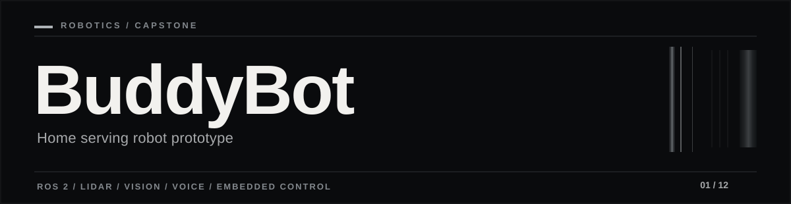
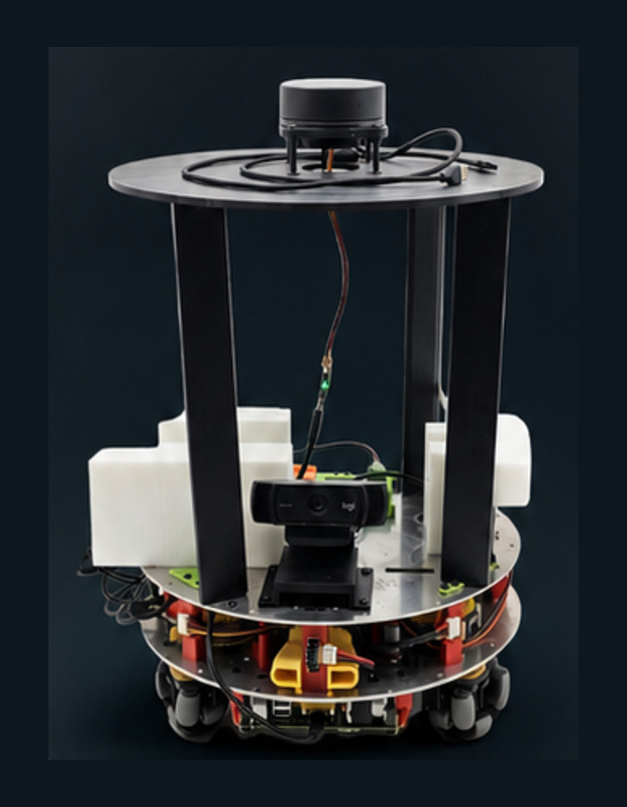
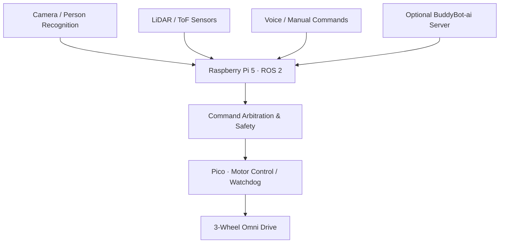

# BuddyBot — ROS 2 Autonomous Indoor Robot

  🌐 README language · <a href="README.md">🇰🇷 한국어</a> · <strong>🇺🇸 English</strong>

  
  
<strong>Home AI serving robot concept · Indoor navigation and interaction prototype</strong>

<table>
<tr>
<td width="42%" align="center"></td>
<td valign="top"><strong>Project snapshot</strong>  2025.03 – 2026.06 Three-person team  <strong>My role:</strong> Team lead, overall system architecture and integration  <strong>Outcome:</strong> Integrated indoor mobile robot, with documented physical demonstrations.</td>
</tr>
</table>

## Project origin and development goals

**Development period:** March 2025–June 2026 · **Three-person team; team lead, architecture, and integration**

**Original concept:** Build a home AI serving robot that could respond to spoken requests, perceive an indoor environment, avoid obstacles, navigate to locations, and follow people when needed. We broke this goal into the capabilities required for a functional mobile robot prototype.

| Required capability | Selected approach |
| --- | --- |
| Indoor sensing and obstacle avoidance | LiDAR, ToF sensors, ROS 2 navigation |
| Object and person recognition | Camera-based detection and person following |
| Spoken interaction | Microphone, speech-to-text, voice commands and responses |
| Motion and stopping | Three-wheel omni drive, encoders, command mux, watchdog |
| Integration | Raspberry Pi 5 for perception/navigation; Pico for motor control over UART |

**Built and demonstrated:** Checkpoint navigation, obstacle avoidance, person following, voice/manual control, and software emergency stop on the physical robot.

**Boundary:** This is a prototype of indoor mobility, perception, and interaction features. End-to-end physical item carrying/delivery and consumer-grade reliability or safety have not been demonstrated.

## The engineering problem

The robot needs AI perception and ROS 2 planning without letting nondeterministic Linux processes directly compromise motor responsiveness or emergency stopping.

**BuddyBot separates its brain from its spinal control loop:**
- **Raspberry Pi 5:** ROS 2 Jazzy, perception, sensor fusion, navigation, command mediation, and voice integration.
- **Raspberry Pi Pico / RP2040:** 50 Hz motor-control loop, encoder feedback, and watchdog-oriented safety behavior.
- **Server PC (optional):** [BuddyBot-ai](https://github.com/rasasoe/BuddyBot-ai), a companion AI and management backend.

## Demonstrated capabilities

| Area | Project implementation |
| --- | --- |
| Indoor movement | Checkpoint-based movement and obstacle avoidance |
| Person following | Camera-based detection and motion tracking, with physical movement demonstrations |
| Voice interactions | Voice-driven control and server-assisted responses |
| Navigation feedback | LiDAR mini-map and robot status displays |
| Safety | Command mediation, software emergency stop, and low-level watchdog concept |

The original README includes actual demo videos, screenshots, photographs, and a detailed separation between demonstrated behavior and unverified future improvements.

## Development and team ownership

**Team lead / system architect / integrator**, coordinating robot bring-up, subsystem interfaces, troubleshooting, and the final demonstration. Component development was shared across the three-person team, not claimed as one person's individual authorship.

The technical progression from [MRP3MV4](https://github.com/rasasoe/MRP3MV4) → [AMR](https://github.com/rasasoe/AMR) → **BuddyBot** reflects reused engineering ideas, not a single continuous source-code history.

## Real-world validation limits

- The documented videos and photos are records of physical tests, not fresh performance measurements.
- Reproducing the hardware stack requires ROS 2 Jazzy, compatible sensors/motor hardware and device-specific configuration.
- Hardware-in-the-loop and CI regression coverage remain improvement areas.

## Explore

**[한국어 전체 README / Korean documentation](README.md)** — robot demos, wiring, architecture, launch steps, design decisions and detailed evidence.

**[BuddyBot-ai companion server](https://github.com/rasasoe/BuddyBot-ai)**

---

*BuddyBot · Robotics / Embedded Systems · Team Project*
