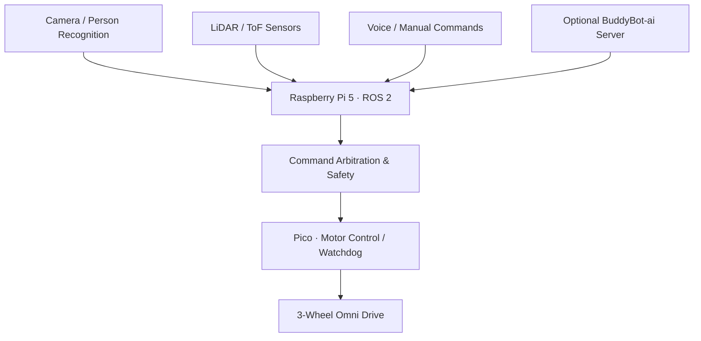

# BuddyBot — ROS 2 Autonomous Indoor Robot

  🌐 README language · <a href="README.md">🇰🇷 한국어</a> · <strong>🇺🇸 English</strong>

  
  
<strong>Vision · Navigation · Voice · Embedded Motor Control</strong>

  

    
    
    
    
  

<table>
<tr>
<td width="42%" align="center"></td>
<td valign="top"><strong>Project snapshot</strong>  2025.03 – 2026.06 Three-person team  <strong>My role:</strong> Team lead, overall system architecture and integration  <strong>Outcome:</strong> Integrated indoor mobile robot, with documented physical demonstrations.</td>
</tr>
</table>

## The engineering problem

The robot needs AI perception and ROS 2 planning without letting nondeterministic Linux processes directly compromise motor responsiveness or emergency stopping.

**BuddyBot separates its brain from its spinal control loop:**
- **Raspberry Pi 5:** ROS 2 Jazzy, perception, sensor fusion, navigation, command mediation, and voice integration.
- **Raspberry Pi Pico / RP2040:** 50 Hz motor-control loop, encoder feedback, and watchdog-oriented safety behavior.
- **Server PC (optional):** [BuddyBot-ai](https://github.com/rasasoe/BuddyBot-ai), a companion AI and management backend.

## Demonstrated capabilities

| Area | Project implementation |
| --- | --- |
| Indoor movement | Checkpoint-based movement and obstacle avoidance |
| Person following | Camera-based detection and motion tracking, with physical movement demonstrations |
| Voice interactions | Voice-driven control and server-assisted responses |
| Navigation feedback | LiDAR mini-map and robot status displays |
| Safety | Command mediation, software emergency stop, and low-level watchdog concept |

The original README includes actual demo videos, screenshots, photographs, and a detailed separation between demonstrated behavior and unverified future improvements.

## Development and team ownership

**Team lead / system architect / integrator**, coordinating robot bring-up, subsystem interfaces, troubleshooting, and the final demonstration. Component development was shared across the three-person team, not claimed as one person's individual authorship.

The technical progression from [MRP3MV4](https://github.com/rasasoe/MRP3MV4) → [AMR](https://github.com/rasasoe/AMR) → **BuddyBot** reflects reused engineering ideas, not a single continuous source-code history.

## Real-world validation limits

- The documented videos and photos are records of physical tests, not fresh performance measurements.
- Reproducing the hardware stack requires ROS 2 Jazzy, compatible sensors/motor hardware and device-specific configuration.
- Hardware-in-the-loop and CI regression coverage remain improvement areas.

## Explore

**[한국어 전체 README / Korean documentation](README.md)** — robot demos, wiring, architecture, launch steps, design decisions and detailed evidence.

**[BuddyBot-ai companion server](https://github.com/rasasoe/BuddyBot-ai)**

---

*BuddyBot · Robotics / Embedded Systems · Team Project*
