<p align="right"><strong>한국어</strong> &nbsp; / &nbsp; <a href="README.en.md">English</a></p>

<picture>
  <source media="(max-width: 600px)" srcset="docs/assets/portfolio/buddybot-banner-mobile.svg">
  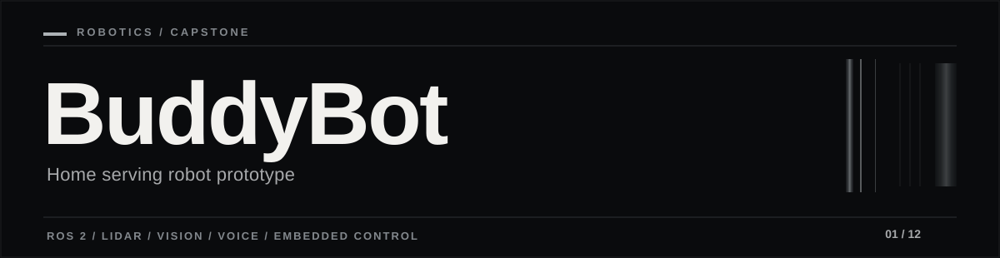
</picture>

# BuddyBot — 가정용 AI 서빙 로봇 프로토타입  
2025.03–2026.06 · 3인 팀 · **팀장 / 시스템 아키텍처 설계·통합**

<p align="center">
  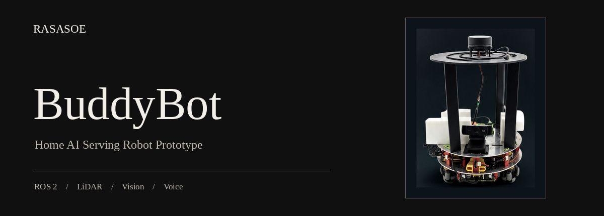
</p>

가정에서 음성으로 요청하면 주변을 인식하고, 장애물을 피해 이동하며, 필요할 때 사람을 따라오는 **AI 서빙 로봇을 직접 만들어보자**는 아이디어에서 시작했습니다. 그 목표에 필요한 구동·센서·음성·인지 기능을 단계적으로 구현하고 ROS 2 기반의 실물 프로토타입으로 통합했습니다.

[로봇 개발 과정](#개발의-흐름-mrp3mv4--amr--buddybot) · [실물 주행 영상](#실제-동작-시연) · [시스템 아키텍처](#시스템-아키텍처) · [내 역할](#팀-구성과-담당-역할)

---

## 기획: 무엇을 만들고 싶었나

집에서 사용자의 요청에 반응하는 로봇을 만들려면, 단순히 바퀴만 움직이는 것으로는 부족합니다. **공간 인식, 사람 인식, 목적지 이동, 음성 상호작용, 안전한 정지**가 한 시스템 안에서 동작해야 합니다.

그래서 다음 기능을 개발 과제로 정했습니다.

- **이동:** 3륜 옴니휠, 엔코더 기반 모터 제어, 목적지 주행
- **주변 인식:** LiDAR·ToF 센서로 장애물 감지 및 회피
- **사람 인식:** 카메라 기반 검출과 사용자 추종
- **상호작용:** 마이크·STT 음성 명령, 응답 및 제어 패널
- **통합·안전:** 서로 다른 입력을 중재하고, 통신 이상 시 정지하는 제어 구조

이 프로젝트의 결과물은 **이동·인지·상호작용 기능을 갖춘 실물 로봇 프로토타입**입니다. 실제 물품의 적재·운반·전달까지 완성한 상용 서빙 로봇으로 소개하지 않습니다.

## 개발의 흐름: MRP3MV4 → AMR → BuddyBot

한 번에 완성형 로봇을 만든 것이 아닙니다. 별도 프로젝트를 거치며 **보드 기반 주행 경험 → 직접 구현한 피드백 제어 → ROS 2 기반 분산 시스템 통합**으로 개발 역량을 확장했습니다. 세 프로젝트는 같은 소스코드를 버전업한 관계가 아니라, 앞선 경험이 다음 설계에 활용된 과정입니다.

### 01 / [MRP3MV4 — AVR 기반 로봇 구동 경험](https://github.com/rasasoe/MRP3MV4)

<p align="center">
  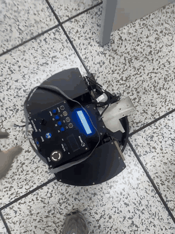
</p>

**무엇을 했나:** AVR·LM629 기반 3륜 홀로노믹 로봇의 구동과 PSD 센서·카메라를 이용한 동작 실험을 수행했습니다. 보드와 제공된 제어·데모 구조를 활용하면서 센서 입력이 이동 동작으로 연결되는 과정을 익혔습니다.

**다음 과제:** 미리 구성된 제어 기능을 사용하는 데서 나아가, 모터 속도 제어와 엔코더 피드백을 직접 구현해보고 싶었습니다.

### 02 / [AMR — Pico 기반 엔코더·P제어 구현](https://github.com/rasasoe/AMR)

<p align="center">
  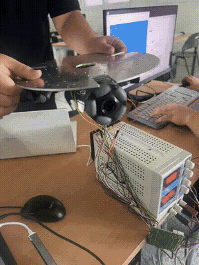
</p>

**무엇을 했나:** Raspberry Pi Pico에서 바퀴별 엔코더 값을 읽고, **P제어**로 목표 속도와 실제 속도의 차이를 줄이는 로직을 구현했습니다. 역기구학을 이용해 로봇의 이동 방향·회전 요구를 각 바퀴의 목표 RPM으로 변환했습니다.

**다음 과제:** 로봇이 바퀴를 안정적으로 돌리는 것만으로는 실내 서비스가 불가능합니다. 환경·사람을 인식하고, 자율주행·음성 명령과 모터 제어를 하나의 시스템으로 연결해야 했습니다.

### 03 / BuddyBot — ROS 2 기반 실내 AI 로봇 통합

**무엇을 했나:** Raspberry Pi 5에서 LiDAR·카메라·음성 입력과 ROS 2 주행·추종 기능을 처리하고, Raspberry Pi Pico에 모터 구동과 watchdog을 분리했습니다. 서로 다른 명령은 `command_mux`에서 우선순위를 결정하도록 설계했습니다.

**결과:** 실물 로봇으로 체크포인트 자율이동, 장애물 회피, 사용자 추종, 음성·수동 제어 및 비상정지를 시연했습니다. 아래 영상에서 실제 동작을 볼 수 있습니다.

## 실제 동작 시연

### 체크포인트 이동 · LiDAR 장애물 회피

<p align="center">
  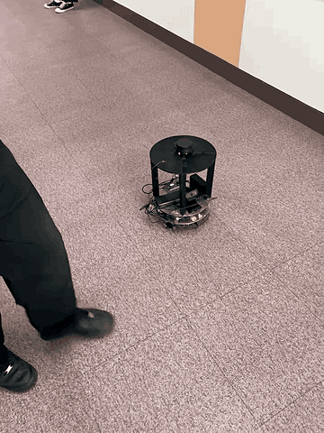
</p>

[색감 보정 GIF](docs/assets/portfolio/checkpoint-navigation-polished.gif) · [촬영 원본에서 만든 기존 GIF](docs/assets/portfolio/checkpoint-navigation.gif)

저장한 체크포인트를 향해 주행하면서 LiDAR로 장애물을 감지하고, 회피·정지 명령을 반영하는 실물 데모입니다.

### 카메라 기반 사용자 추종

<p align="center">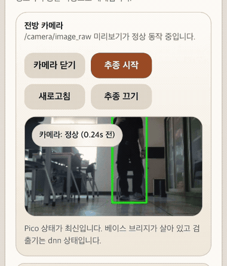</p>

<p align="center">
  <a href="docs/assets/portfolio/person-follow-physical.mp4">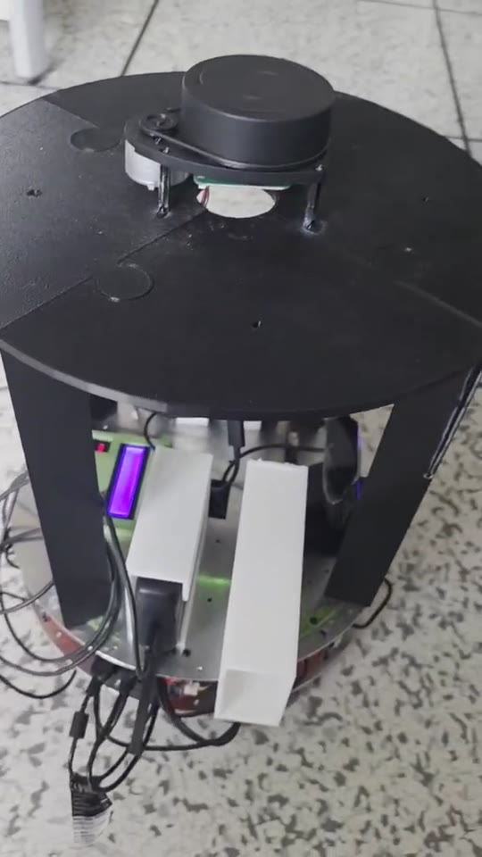</a>
</p>

[실물 사용자 추종 영상 보기](docs/assets/portfolio/person-follow-physical.mp4) — 위는 인식·제어 화면, 아래는 실제 로봇의 움직임입니다.

### 음성 명령으로 로봇 이동

<p align="center">
  <a href="docs/assets/portfolio/voice-command.mp4">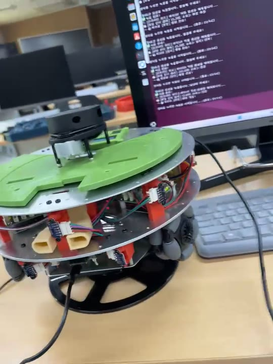</a>
</p>

[음성 포함 원본 영상 보기](docs/assets/portfolio/voice-command.mp4) — 음성 인식 결과를 Pi 5에서 로봇 명령으로 판단하고 ROS 2–Pico 제어 경로로 연결했습니다.

### 서버 AI 질의응답

<p align="center">
  <a href="docs/assets/portfolio/weather-assistant.mp4">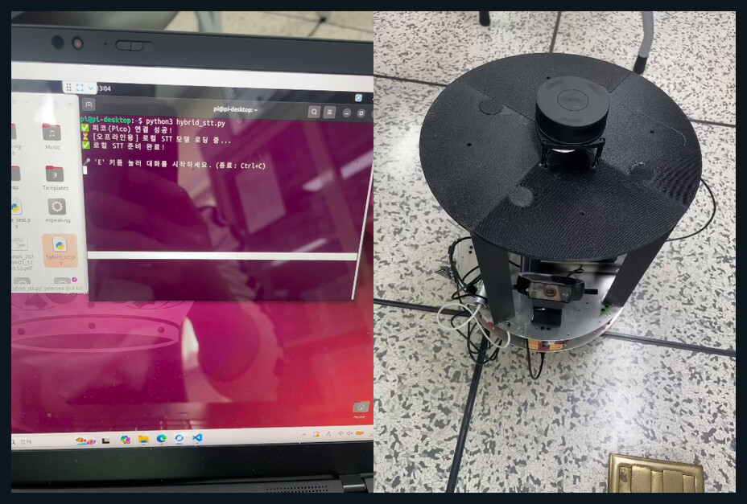</a>
</p>

[음성 질의응답 영상 보기](docs/assets/portfolio/weather-assistant.mp4) — 선택적 [BuddyBot-ai](https://github.com/rasasoe/BuddyBot-ai) 서버가 STT/TTS와 고수준 요청을 처리합니다.

## 시스템 아키텍처

<picture>
  <source media="(max-width: 600px)" srcset="docs/assets/portfolio/architecture-mobile.svg">
  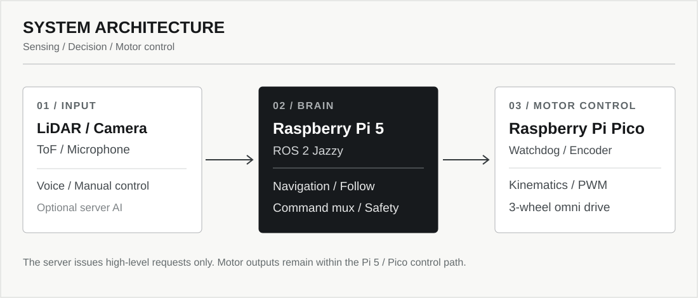
</picture>

**Raspberry Pi 5 · Brain** — ROS 2 Jazzy에서 LiDAR·카메라·음성 입력을 처리하고 자율이동, 추종, 수동 명령 및 안전 제어의 우선순위를 중재합니다.

**Raspberry Pi Pico · Motor/Safety** — 운동학, 엔코더 피드백, PWM 구동, heartbeat 감시와 watchdog 정지를 담당합니다. Pi 5와는 USB CDC 기반 텍스트 프로토콜로 연결했습니다.

**BuddyBot-ai · Optional server** — STT/TTS, 대화형 응답, 웹 GUI 및 고수준 동작 요청을 제공합니다. 서버 AI는 모터 PWM을 직접 만들지 않습니다.

### 특히 신경 쓴 기술 문제

1. **명령 충돌:** 자율주행·추종·수동 명령이 동시에 발생할 수 있어 `command_mux`를 통해 최종 속도 명령을 하나로 결정했습니다. 우선순위는 `E-STOP > Safety Override > Manual > Navigation > Follow > Idle`입니다.
2. **Linux 프로세스와 모터 제어의 분리:** 센서·AI 처리가 느려지거나 통신이 끊겨도 Pico의 watchdog이 정지하도록 상·하위 제어 책임을 나눴습니다.
3. **현장 디버깅:** Pi 5–Pico 사이에 `HB`, `CMD`, `ACK`, `STAT`, `SAFE` 등의 line-based 메시지를 사용해 통신과 장애 상태를 확인할 수 있게 했습니다.

### 실제 통합 화면과 하드웨어

<p align="center">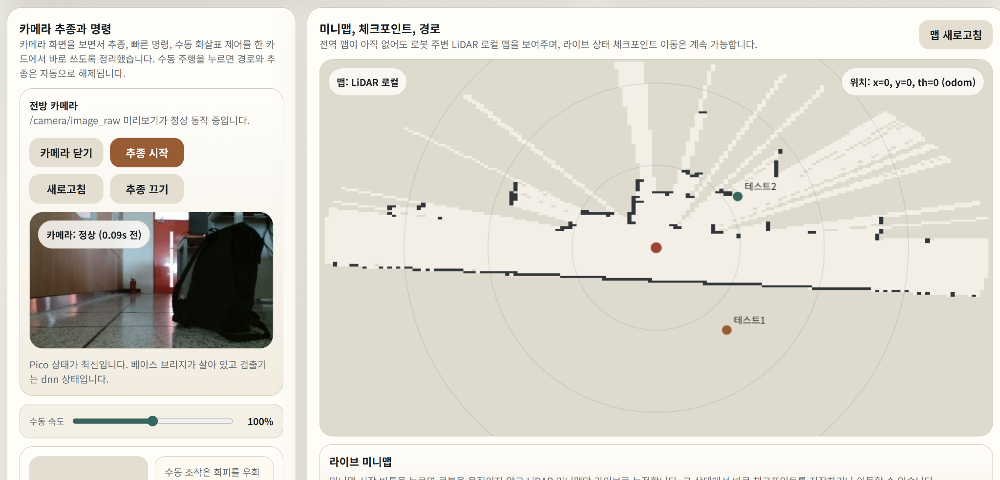</p>

<details>
<summary><strong>Raspberry Pi 5 / Pico 배선 및 초기 센서 테스트 보기</strong></summary>

**Pi 5 · 센서와 상위 제어**

<p align="center">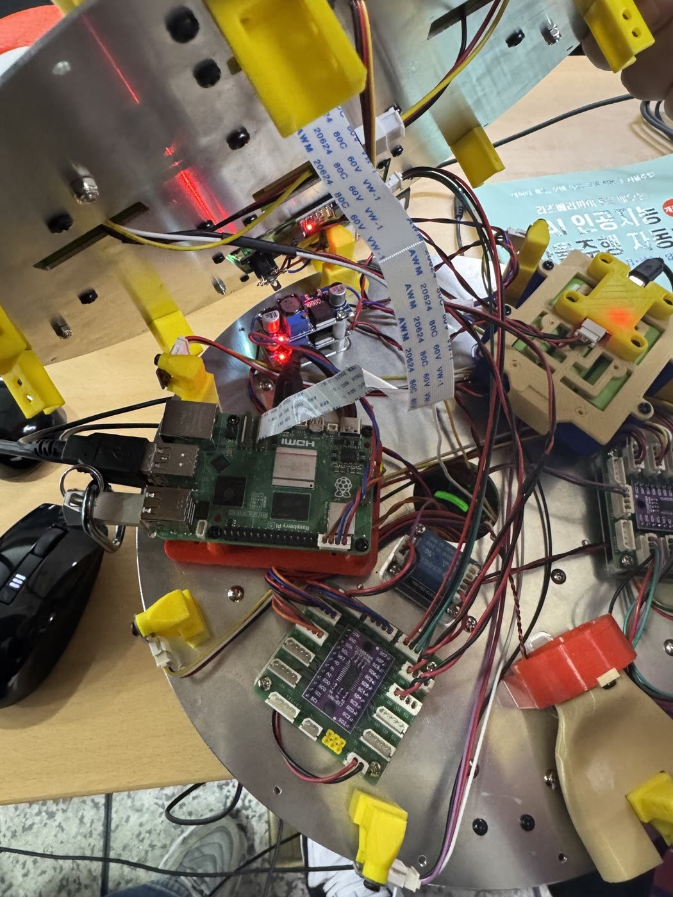</p>

**Pico · 모터·엔코더 제어**

<p align="center">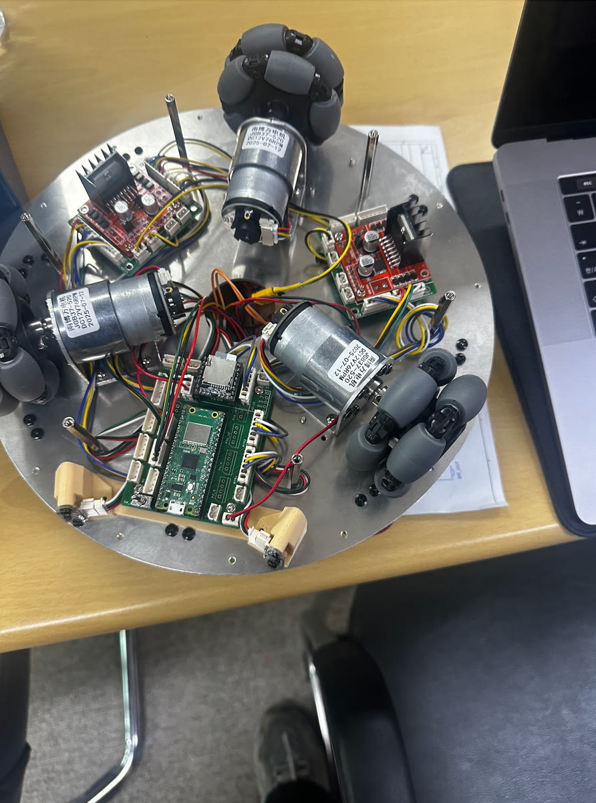</p>

**LiDAR 스캔 초기 테스트**

<p align="center">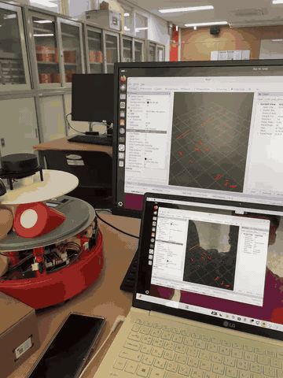</p>

**카메라 객체 인식 초기 테스트**

<p align="center">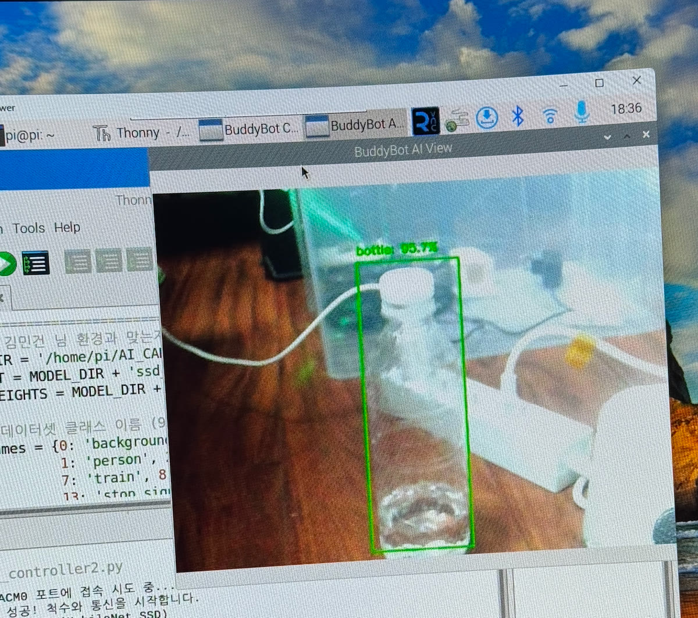</p>

</details>

## 팀 구성과 담당 역할

**3인 팀 · 팀장 / 전체 아키텍처 설계와 시스템 통합**

- Pi 5와 Pico의 책임 분리, 통신 구조 및 ROS 2 노드 간 최종 제어 흐름 설계
- LiDAR·카메라·모터·엔코더와 추종·자율주행·음성 기능의 시스템 통합
- 명령 우선순위 및 안전정지 경로 구성, 실물 bring-up·장애 분석·시연 조율

각 기능의 세부 구현은 팀원들과 분담했으며, 팀 전체 결과를 개인 단독 개발로 주장하지 않습니다.

## 결과와 한계

**확인한 결과:** 체크포인트 이동, 회피·추종, 음성 제어, 상태 패널, 소프트웨어 비상정지 등 실제 로봇의 동작을 영상과 통합 화면으로 남겼습니다.

**남은 과제:** 물품 적재·전달의 전체 서빙 과정, 독립적인 물리 E-STOP, 반복 실험 기반 주행·정지 성능 수치화, 하드웨어 회귀 테스트, 웹 패널 접근 제어 고도화.

시연 영상은 구현 결과의 근거이지, 모든 조건에서의 안정성·안전성 인증이나 정량적 성공률을 뜻하지 않습니다.

## 저장소 구성과 실행 문서

```text
BuddyBot/
├── firmware/pico_motor_controller/      # Pico 모터·엔코더·안전 제어
├── software/pi5/ros2_ws/src/             # Pi 5 ROS 2 패키지
│   ├── buddybot_base/                    # Serial bridge, odometry
│   ├── buddybot_system/                  # Command mux, safety, LiDAR
│   ├── buddybot_nav/                     # Waypoint navigation
│   ├── buddybot_vision/                  # Person following
│   ├── buddybot_voice/                   # Voice commands
│   └── buddybot_panel/                   # Web/mobile dashboard
├── scripts/
└── docs/
```

[시스템 설계](docs/architecture.md) · [Pi 5·Pico 설치](docs/TEAM_SETUP_PI5_AND_PICO.md) · [실물 구동](docs/bringup.md) · [USB 프로토콜](docs/uart_protocol.md) · [음성 명령](docs/voice_commands.md)

```bash
cd ~/BuddyBot
bash scripts/start_presentation_mode.sh mapping
```

실행에는 Raspberry Pi 5·Pico·센서와 ROS 2 Jazzy 환경이 필요합니다. 서버 AI의 고수준 인터페이스는 [BuddyBot-ai](https://github.com/rasasoe/BuddyBot-ai)에서 확인할 수 있습니다.
